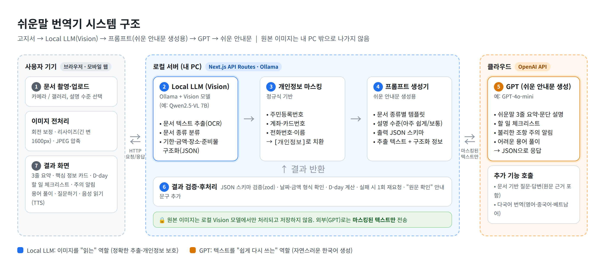
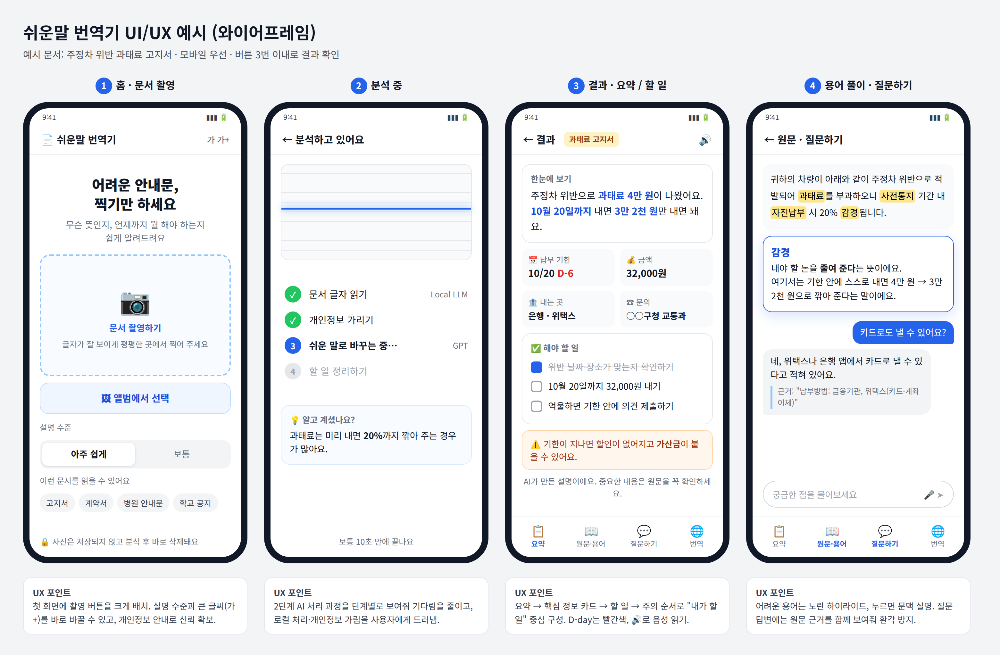

# 📄 쉬운말 번역기 (Easy Notice)

> **어려운 안내문을 찍으면 "내가 할 일"로 바꿔주는 생성형 AI 서비스**

동양미래대학교 컴퓨터소프트웨어공학과 **인공지능프로젝트** 개별 프로젝트 (2026-2학기) · 🚧 개발 중

---

## 💡 프로젝트 개요

고지서, 임대차계약서, 병원·학교 안내문처럼 **전문용어와 한자어가 많은 생활 문서**를 사진 한 장으로 이해하도록 돕는 웹 서비스입니다.

문서를 찍으면 AI가 **① 쉬운 말로 요약**하고, **② 기한·금액 같은 핵심 정보를 정리**하고, **③ 해야 할 일을 체크리스트로** 만들어 줍니다.

**왜 필요한가?** 문서를 이해하지 못하면 납부 기한을 놓쳐 가산금을 내거나, 계약서의 불리한 조항을 모르고 서명하는 등 실제 손해로 이어집니다. 기존 번역기나 챗봇은 요약만 해 줄 뿐 **"언제까지 무엇을 해야 하는지"**는 알려주지 않습니다.

**예상 사용자:** 어르신, 외국인 주민·유학생, 사회초년생·대학생, 부모님 문서를 대신 봐 드리는 보호자

> **예시 —** 과태료 고지서를 찍으면
> "주정차 위반으로 **과태료 4만 원**이 나왔어요. **10월 20일까지** 내면 **3만 2천 원**만 내면 돼요."
> ✅ 10월 20일까지 32,000원 내기 · ⚠️ 기한이 지나면 가산금이 붙을 수 있어요

---

## ✨ 주요 기능

| 기능 | 설명 |
|---|---|
| ⭐ **문서 인식·쉬운말 요약** | 문서 종류를 판별하고, 설명 수준(아주 쉽게/보통)에 맞춰 요약 |
| ⭐ **핵심 정보·할 일 체크리스트** | 기한(D-day)·금액·제출처 카드, 할 일 목록, 불리한 조항 주의 알림 |
| ⭐ **어려운 용어 풀이** | 원문의 어려운 용어를 하이라이트하고 문맥에 맞게 설명 |
| 문서 기반 질문·답변 | 궁금한 점에 문서 내용을 근거로 답변 (근거 원문 표시) |
| 음성 읽기·다국어 번역 | TTS 음성 읽기, 영어·중국어·베트남어 번역 |

---

## 🏗 시스템 구조



```
고지서 사진 → Local LLM(Vision) → 개인정보 마스킹 → 프롬프트 생성 → GPT → 쉬운 안내문
             (내 PC · Ollama)                                  (OpenAI API)
```

AI를 **2단계**로 나눴습니다.

- **Local LLM (Vision):** 내 PC에서 이미지를 읽어 텍스트를 추출하고 기한·금액 등을 JSON으로 정리합니다.
- **GPT:** 개인정보를 가린 텍스트를 받아 쉬운 안내문, 할 일, 용어 풀이를 만듭니다.

그래서 **원본 이미지가 외부 서버로 나가지 않고**, GPT에는 마스킹된 텍스트만 전송됩니다.

---

## 🎨 화면 구성



홈(문서 촬영) → 분석 중(단계별 진행 표시) → 결과(요약·정보 카드·할 일) → 원문·용어 / 질문하기

---

## 🛠 기술 스택

| 구분 | 기술 |
|---|---|
| Frontend / Backend | Next.js (App Router), TypeScript, Tailwind CSS, API Routes |
| Local LLM | Ollama + Vision 모델 (Qwen2.5-VL 등, 비교 후 확정) |
| Generative AI | OpenAI API (GPT-4o-mini 등) |
| 기타 | zod (출력 검증), Web Speech API (TTS) |

---

## 🚀 실행 방법

**요구 사항:** Node.js 20+, [Ollama](https://ollama.com), OpenAI API 키

```bash
git clone https://github.com/chiyyy/easy-notice.git
cd easy-notice
npm install
ollama pull qwen2.5vl:7b    # 확정 모델로 변경 예정
```

`.env.local` 파일 생성:

```env
OPENAI_API_KEY=sk-...
OLLAMA_BASE_URL=http://localhost:11434
OLLAMA_VISION_MODEL=qwen2.5vl:7b
```

```bash
npm run dev   # http://localhost:3000
```

---

## 📅 개발 일정

| 기간 | 목표 |
|---|---|
| 9/30 ~ 10/13 | 기획, 화면 설계, AI 구조 확정 ✅ |
| 10/14 ~ 11/3 | 구현 (로컬 Vision → GPT 연동 → 기능 1~4), MVP 완성 |
| 11/4 ~ 11/17 | 테스트·개선, 발표 준비 |
| **11/18** | 수업 프로젝트 발표 |
| 11/19 ~ **12/2** | 고도화, 교내 경진대회 |

---

> ⚠️ AI가 만든 설명은 틀릴 수 있습니다. 중요한 결정은 원문과 해당 기관을 통해 확인하세요.

**개발자:** [조혜인] · [hyein031114@gmail.com]
